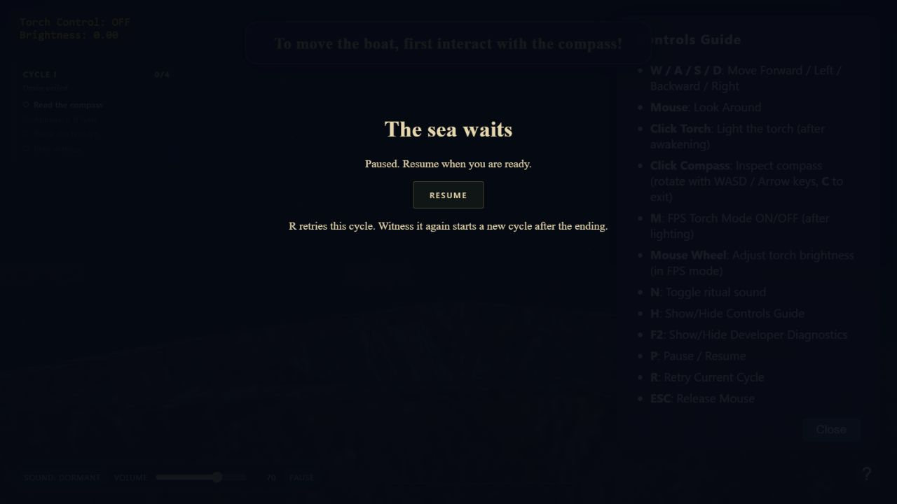

# Ritüel VIII — Sağlam Güverte

18 Ekim 2026 · Durum: **Doğrulama bekliyor**

Kod uygulandı; otomatik testler ve sınırlı gerçek tarayıcı doğrulaması geçti. Gerçek fare kilidiyle tam oynanış, final ve 10 reset matrisi kapanmadığı için ritüel tamamlandı olarak işaretlenmedi. Ritüel IX'a başlanmadı.

## Uygulanan davranış

- Hareket basılı tuşlar üzerinden saniye başına 9 dünya birimiyle hesaplanıyor; çapraz giriş normalize ediliyor. Bu hız eski 0,3 birim/tuş tekrarının yaklaşık 30 tekrar/saniye karşılığıdır; son oynanış ayarı tarayıcı kontrolünde değerlendirilecek.
- P veya Pause sahneyi durduruyor. Sekme gizlenmesi/pencere odağı kaybı da durduruyor; dönüşte bilinçli Resume gerekiyor. Sahne, tur süresi, altyazı ve final gecikmesi aynı sınırlanmış aktif zamanla ilerliyor; duvar saati kullanılmıyor.
- Menü alanına odaklanınca ve fare kilidi değişince basılı tuşlar temizleniyor. Finalde fare bırakılıyor ve odak Continue düğmesine geliyor. Pause/final içinde Tab odağı düğmeler arasında tutuluyor.
- Kilit isteğinin senkron/asenkron reddi görünür durum mesajıyla karşılanıyor; başarılı kilitte mesaj temizleniyor.
- R ve tanılama Reset aynı turu/alameti tekrar başlatıyor. Finaldeki Witness it again turu artırıyor. Pusula açıları, hover, fener, görevler, altyazılar ve gecikmiş final temizleniyor.
- Geçici ses kaynakları reset/duraklatmada durduruluyor; rumble otomasyonları resette iptal ediliyor. Duraklatma ana miksini susturuyor; ses düzeyi değişikliği bunu bozmuyor. Sürekli ortam kaynakları sessiz çalışmaya devam eder; duraklatılmış sahne olay üretmez. Kesilen tek seferlik sesler dönüşte tekrar çalınmaz.
- Performans sayacı sınırlanmamış kare aralıklarını ölçüyor. F2 → Capture measurements tarayıcı, görünüm/render boyutu, kalite, başlangıç yükleme süresi ve son 600 aktif kareye kadar p95 ölçümünü sunuyor. FPS/ortalama kare süresi son yaklaşık yarım saniyelik penceredir; donanım bilgisi otomatik toplanmıyor.
- Duraklatma ekranı yardım/tanılama katmanlarının üstüne alındı; geliştirme ritüeli numarası final başlığından kaldırıldı.

## Otomatik doğrulama — PASS

`node --test scripts/ritual-08.test.js`: **10/10 geçti**.

Gerçek sahne modülleri ve olay işleyicileri Node VM içinde çalıştırılıyor. DOM, AudioContext sınırları ve GPU başlangıcı taklit ediliyor; bu testler WebGL görüntüsü veya gerçek ses çıktısı kanıtı değildir.

1. 30/60/120 FPS'de 5 saniyede 45 birim hareket; düz/çapraz farkı sayısal toleransın altında.
2. Tuş bırakma, zıt yön, arayüz odağı ve pusula/uyanış hareket kapıları.
3. Odak kaybında giriş temizleme, fare bırakma ve sahne/ses duraklatma.
4. Gizli sekmede tur, sahne ve final sayacının donması; gizliyken devamın engellenmesi.
5. Final açılınca fareyi bırakma, düğmeye odaklanma, Tab döngüsü ve devam.
6. Art arda 10 resette açıların/sahnenin temizlenmesi, eski finalin açılmaması ve aynı turda kalma; yeni tur düğmesinin sayacı artırması.
7. R tuş tekrarının tekrar reset üretmemesi; arayüz odağında kısayol engeli.
8. Fare kilidi reddinin görünür bildirimi ve başarılı istekte temizlenmesi.
9. Gerçek 250 ms kareyi 4 FPS raporlayıp simülasyonu 100 ms ilerletme; bitmiş tur istatistiğini sabitleme.
10. Reset/duraklatmada geçici seslerin durdurulması, otomasyon iptali ve duraklatmada ses düzeyi koruması.

Ek kontroller: `node scripts/validate.js`, `main.js` ve `js/`/`scripts/` içindeki JavaScript dosyalarının `node --check` kontrolleri; `git diff --check`.

## Gerçek tarayıcı gözlemleri

Yerel sunucu korumalı ortamda başlatıldığında tarayıcı/HTTP erişimi başarısız oldu. Aynı sunucu izin verilerek korumalı ortam dışında yeniden başlatıldığında erişim sağlandı.

- Tarayıcı: in-app Chromium; kullanıcı aracısı **Chrome/155.0.0.0**, Windows NT 10.0, Win64/x64.
- Görünüm: **1280 × 720**, DPR **1,25**; render **1600 × 900**; kalite **high**.
- Yeniden yükleme örneğinde hazır olma süresi: **1624,5 ms**. Önbellek koşulları kontrol edilmedi; soğuk yükleme ölçümü değildir.
- Başlangıç sahnesinde 233 aktif karelik örnek: son raporlama penceresi **56,43 FPS / 17,72 ms**, örneğin p95 değeri **27,8 ms**. Uyanış/final performansını veya hedef masaüstü donanımını temsil etmez.
- İlk ölçüm sırasında konsolda error/warn kaydı yoktu; sahne çizildi, shader programı ve varlık yükleme tamamlandı.
- Pause ekranı açıldı; Resume'a odak geldi; Tab odağı ekranda kaldı. Resume sahneyi sürdürdü.
- In-app tarayıcı fare kilidi isteğini reddetti; yeni görünür hata mesajı gerçek ortamda doğrulandı. Bu nedenle gerçek fare kilidiyle kamera/final kontrolü yapılmadı.
- Tanılama düğmesinden uyanış başlatıldı; görev/alamet ve anlatı yazısı güncellendi. Bu işlem pusula/yaklaşma yolunu atladığı için tam oynanış kanıtı değildir.
- `/`, `main.js`, `js/scene-controls.js` ve iki shader HTTP **200** verdi. Tek sıralı yerel istek örneğinde yanıt süreleri sırasıyla 222,17 / 110,48 / 25,19 / 17,01 / 17,86 ms; ağ veya yükleme performansı kıyaslaması değildir.

## Kapanış için açık kontroller

- Fare kilidi destekleyen normal masaüstü tarayıcıda pusula → yaklaşma → uyanış → fener → final → devam/yeni tur tam akışı.
- Gerçek fare kilidinin final/duraklatmada bırakılıp kullanıcı tıklamasıyla yeniden alınması.
- Gerçek tarayıcıda pusula inceleme, uyanış, tanıklık ve final aşamalarına yayılmış 10 reset; otomatik 10 reset testi geçti, görsel kontrol ayrı bekliyor.
- Gerçek sekme değiştirme/pencere odağı kaybında görüntü, sayaç, altyazı ve işitilebilir sesin birlikte durup devam etmesi. Otomatik olay testi geçti; insan gözlemi/dinleme bekliyor.
- Kontrollü soğuk yükleme, test donanımı ve uyanış/final kare süresi ölçümü. Mevcut başlangıç örneği karşılaştırma için saklandı; performans hedefleri XIV'te kesinleştirilecek.

Tamamlanan işin kapsamı Ritüel VIII ile sınırlı. 3D hareket azaltma ve alamet karıştırma IX'a bırakıldı. Commit/push veya yayınlama yapılmadı.
