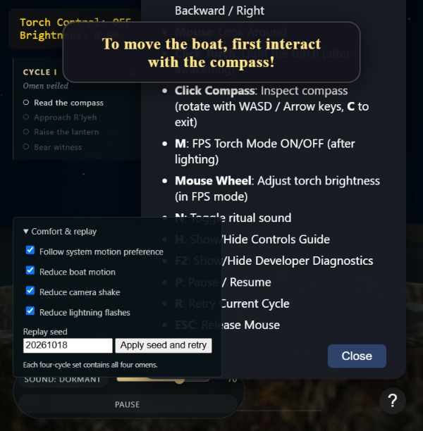

# Ritüel IX — Sakin Bakış

18 Ekim 2026 · Durum: **Doğrulama bekliyor**

## Uygulama

- Comfort & replay menüsü: sistem tercihini izleme, tekne salınımını kaldırma, kamera sarsıntısını kaldırma ve yıldırım parlaklığını azaltma ayrı ayarlar.
- Sistem tercihi her karede okunuyor; açık sekmede tercih değişirse sahne de değişiyor. Sistem takibi kapatılınca bireysel seçimler geçerli.
- Azaltılmış yıldırım normal şiddetin %12'si ve en fazla 0,22 ile sınırlandırılıyor. Gözler ve final odak mekaniği yıldırıma bağlı değil.
- Ayarlar ve 32 bit replay seed yerelde saklanıyor; bozuk/engelli depolamada oturum çalışıyor. Seed değişimi aynı turu yeni diziyle tekrar başlatıyor.
- Dört alamet Fisher–Yates ile deterministik dörtlü sıralara dağıtılıyor. Her blokta tüm profiller var; blok sınırında aynı alamet gelirse ilk iki yer değiştiriyor. R ile tekrar aynı tur/alamet korunuyor.

## Doğrulama

- VIII+IX otomatik testleri: **15/15 PASS**. Beş farklı seed için 100'er tur: tüm dörtlüler eksiksiz, sınırda tekrar yok, aynı seed aynı dizi, geriye/rastgele tur erişiminde tutarlılık.
- Sistem tercihi değişimi, bireysel ayarlar, seed doğrulama, bozuk/engelli kayıt ve yıldırım üst sınırı test edildi.
- Gerçek `main.js` işlevleriyle tekne bob/roll/pitch ve kamera sarsıntısının konfor ayarlarıyla kaldırıldığı otomatik entegrasyon testinde doğrulandı.
- Model/varlık doğrulaması ve JavaScript sözdizimi kontrolleri geçti.
- In-app tarayıcıda üç azaltma ayarı açıldı, sayfa yeniden yüklendi; üçü de seçili kaldı. Konsolda error/warn görülmedi. Test ayarları daha sonra varsayılana geri alındı.

## Açık kontroller

Normal masaüstü tarayıcıda azaltılmış efektlerle tüm döngünün/finalin tamamlanması ve OS tercihi değişiminin gözle kontrolü bekliyor. Otomatik kontroller bu insan doğrulamasının yerine yazılmadı. Kullanıcının sırayla uygulama yönlendirmesi kapsamında geliştirme devam edebilir; açık maddeler XV'e taşınır.
