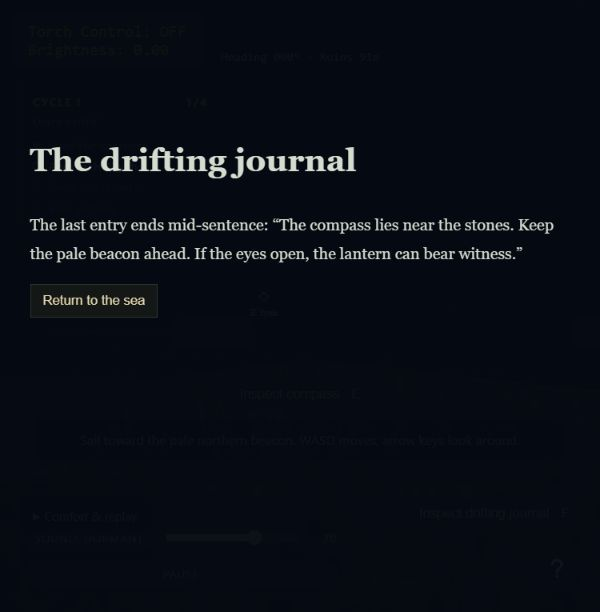
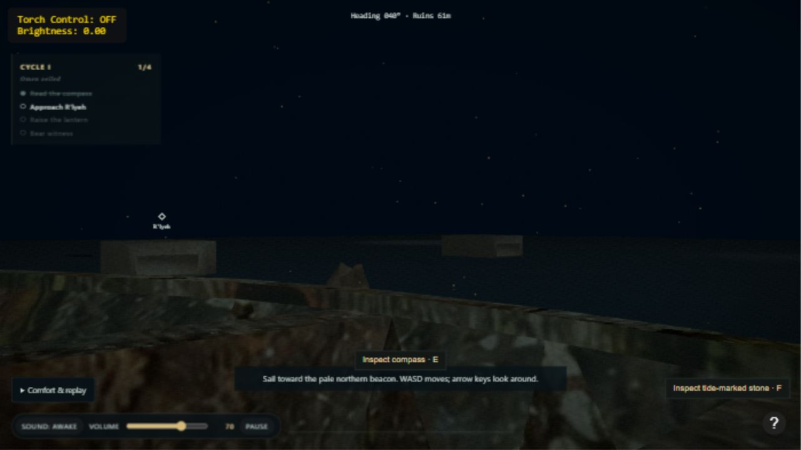

# Ritüel XI — Suyun Getirdikleri

18 Ekim 2026 · Kod uygulandı; insan oynanış doğrulaması açık.

İki isteğe bağlı keşif noktası eklendi: başlangıca yakın sürüklenen günlük ve yaklaşma rotasındaki işaret taşı. Yeni büyük varlık yerine mevcut shader/VAO altyapısında basit ahşap/taş geometrileri kullanılıyor. 18 birim içinde F veya bağlamsal düğmeyle okunur; okuma sahneyi durdurur, fareyi bırakır, kapatınca devam eder. Keşifler uyanışı veya finali kilitlemez.

Fener aynı merkezi işlev üzerinden tıklama/L/düğmeyle yakılır; hedef hizası normalize edilmiş kamera yönüyle hesaplanır. Kapalı aydınlatma veya sıfır ışık final ilerletmez. Kilit göstergesi mevcut halka üzerinden sürer.

Yeni otomatik kontroller: keşif mesafesi, aynı nesneyi yeniden inceleme, reset, iki nesnenin geometrisi ve normalleştirilmiş fener hizası. Önceki testlerle birlikte 20/20 PASS. Üç yeni oyuncuyla test yapılamadı; iki kişinin yardımsız bitirmesi koşulu açık ve XV'e taşındı. Bu koşul sağlandı olarak yazılmadı.

Gerçek in-app tarayıcıda pusula düğmesi→C→günlük düğmesi→okuma→denize dönüş akışı doğrulandı; hedef 1/4 oldu, metin ve doğru odak göründü, konsolda hata/uyarı yoktu.

## İşaret taşı görsel iyileştirmesi

Açık mavi kutu, tabanı suyun altında kalan düzensiz ve kırık yüzeyli bir kayaya dönüştürüldü. Taş malzemesi katman aşınması, yosun, ıslak dip, tuz izi ve soluk oyma işaret içeriyor. Konum ve keşif metni korundu. Geometri deterministik; yüzey normalleri ve su altındaki taban otomatik olarak doğrulandı. Güncel tüm ritüel testleri 31/31 geçti; dosya/model doğrulaması geçti. In-app tarayıcıda sahne açılışı, kaya görünümü ve taşın keşif kartı doğrulandı.

