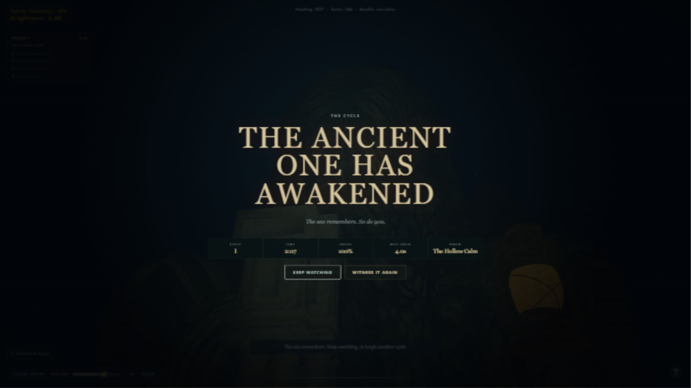

# Ritüel XV — Son Mühür

18 Ekim 2026 · **Geliştirme ve mevcut ortam doğrulaması tamam; yayın kabulü açık.**

X–XIV sırayla uygulandı ve ayrı main commitleriyle kaydedildi. Bu ritüelde tam akış, boyut/kalite, hata yolları ve küçük ekran kontrol edildi. Aşağıdaki açık kontroller nedeniyle proje “tüm kabul ölçütleri geçti / yayına hazır” olarak işaretlenmedi. Push veya yayınlama yapılmadı.

## PASS — Otomatik doğrulama

- `node --test scripts/ritual-*.test.js`: **31 test geçti**.
- Gerçek gl-matrix vektör/matris hesabıyla dört alametin her birinde pusula → seyir → mesafe/bakış tetiklemesi → 42 saniyelik timeline → fener → dört saniye tanıklık akışı çalıştırıldı. Aynı matris, azaltılmış tekne/sarsıntı/yıldırım ayarlarıyla tekrarlandı. Bu test GPU görüntüsü üretmez; nişan hedefi matematikle hesaplanır.
- İki son, bilinçli inkâr onayı, arşiv, 100 turluk alamet dizileri, 30/60/120 FPS hareket, gizli sekme, reset ve ses kaynak temizleme testleri geçti.
- Context kaybında durma/hata, eksik doku yüklemesinde kaynak silme, düşük/yüksek doku bütçesi ve yerel bağımlılık kontrolü geçti.
- Açılış ekranında canvas henüz yokken iki null değerin eşitliği nedeniyle fare olayının işlenebildiği bir hata gerçek tarayıcıda bulundu. Canvas varlık kontrolü ve regresyon testi eklendi.
- `node scripts/validate.js`: tüm modeller ve yüksek/düşük WebP varlıkları doğrulandı. JavaScript sözdizimi ve `git diff --check` geçti.

## PASS — Gerçek tarayıcı

Ortam: Windows üzerinde in-app Chromium, kullanıcı aracısı Chrome/155.0.0.0. Bu test normal Chrome, Edge veya Firefox matrisi yerine sayılmaz.

- Başlangıç ekranı ve Low/Medium/High yüklemeleri, yerel gl-matrix, shader derleme ve sahne çizimi.
- Normal rota: pusula düğmesi → C → W'yi yaklaşık 6 saniye tutma → doğal uyanış → fener düğmesi → ok tuşlarıyla nişan → **4/4 görev**, **%100 odak**, **4,0 saniye** kesintisiz tutuş. Alamet The Hollow Calm. Tur süresi **2:07**; ölçüm/arayı inceleme süresini de içerir, yeni oyuncu süresi değildir.
- Tanıklık sonundaki yeni tur düğmesi **Cycle II / 0/4** açtı.
- İnkâr: tanılama düğmesinden başlatılmış uyanış sonrası Turn away → açık onay → **You Withheld the Light** kartı. Bu son için yaklaşma rotası atlandığından bunu ikinci bir normal tam rota olarak saymıyoruz.
- Günlük açma, okuma sırasında durma, doğru klavye odağı ve denize dönüş.
- Pusula inceleme/indirme sonrası **10 gerçek R reseti**: her defasında **Cycle I / 0/4**. Kanıt `evidence/ritual-15-resets.json`. Uyanış/final aşamalarındaki resetler otomatik testte ayrıca kapsanır.
- Düşük kalite başlangıcında sekiz `low/*.webp` isteği; çalışma anında yüksek kalite seçiminde sekiz `high/*.webp` isteği tamamlandı. Kanıt `evidence/ritual-15-quality-swap.json`.
- Hızlı kalite seçimlerinde eski istekleri iptal etme ve hata halinde son gerçekten uygulanmış kaliteye dönme düzeltildi; yalnız istenmiş ama henüz yüklenmemiş kaliteye geri dönülmüyor.
- `WEBGL_lose_context` ile gerçek grafik bağlamı kaybedildi: simülasyon durdu, açıklama ve Reload scene düğmesi göründü. Düğme başlangıç ekranına döndürdü ve tekrar oyun başlatıldı.
- 360×800 başlangıç/oyun arayüzü kontrol edildi; yön metninin fener paneliyle çakışması düzeltildi. Keşif, konfor, pusula ve yardım kontrolleri yerleştirildi. Bu, dokunmatik oynanabilirlik onayı değildir.
- Pause/Resume, modal Tab odağı ve fare kilidi reddinin anlaşılır klavye alternatifi bildirimi doğrulandı. Ortam fare kilidini reddediyor; normal klavye akışı bununla tamamlandı.
- Context kaybı testinin kasıtlı hata kaydı ve düzeltilmiş açılış hatası tarihsel konsol kaydında bulunur. Düzeltmeden sonraki son kontrol aralığında yeni error/warn yok: `evidence/ritual-15-final-console.json`.

## Ölçümler ve pratik sınırlar

- Yüksek kalite aktif dokular **5,36 MiB**, düşük kalite **0,51 MiB**; kaynaklar **34,65 MiB**. Dosya boyutu karşılaştırması; GPU belleği ölçümü değil.
- 1280×720 / DPR≈1 / High: hazır olma **1384,8 ms**, 600 kare p95 **7,4 ms**, son FPS penceresi **134,29**. VIII'in render1600×900/DPR1,25 örneğiyle doğrudan eşdeğer değil.
- 1920×1080 / DPR≈1 / Medium: hazır olma **2666,1 ms**, 600 kare p95 **20,9 ms**, son FPS penceresi **85,98**. Uyanış örneği **85,03 FPS / p95 20,9 ms**. Ortalama bu örnekte 60 FPS üstünde; bütün kareler/cihazlar için 60 FPS garantisi değil.
- 360×800 / Low yüklemesinde dosya listesi, transfer ve çözülmüş gövde boyutları kaydedildi. Küçük ekran performansı 1080p ile kıyaslanmamalı.
- İlk kullanım/önbellek koşulları tamamen kontrol edilmedi; bu yükleme örnekleri kontrollü soğuk ağ testi sayılmaz. FPS son yaklaşık yarım saniyeyi, p95 son en fazla 600 aktif kareyi tanımlar.

JSON kanıtları `evidence/ritual-14-high.json`, `ritual-15-medium-1080p.json`, `ritual-15-reveal.json`, `ritual-15-low-360.json` dosyalarındadır.

## OPEN — İnsan veya başka ortam gerektiren kabul kontrolleri

1. Normal Chrome, Edge ve Firefox'ta iki son × dört alamet tam matrisi ve gerçek fare kilidi giriş/çıkışı. Mevcut araçta yalnız in-app Chromium erişimi var.
2. Gerçek sekme gizlenmesi/işletim sistemi odak değişimiyle görüntü/ses/zamanın birlikte durması. Simüle olay testleri geçti; in-app ayrı sekme denemesinde belge `hidden=false` kaldığı için platform görünürlüğünü normal tarayıcı gibi doğrulamadık.
3. Projeyi bilmeyen üç kişinin testi; en az ikisinin sözlü yardım olmadan bitirmesi. Gerçek insan katılımcı verisi üretilemedi.
4. Kulaklık ve dizüstü hoparlörü dinlemesi; dört alamette karanlık hedef okunabilirliği ve doku kalite kaybının insan değerlendirmesi.
5. Donanımı tanımlı kontrollü soğuk yükleme ve farklı GPU'larda performans karşılaştırması. Mevcut örneklerde CPU/GPU modeli alınmadı.

Bu maddeler açık kaldığı sürece ilgili ritüellerin kabul durumu “Doğrulama bekliyor”dur. Yeni özellik geliştirmesi kalmadı; kalan iş bu kabul matrisidir. Kullanıcının sıralı uygulama isteği kapsamında kod/rapor/commit dizisi XV'e kadar tamamlandı.
