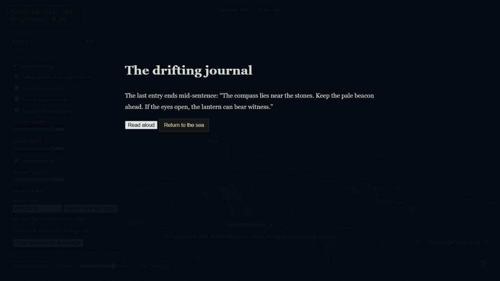
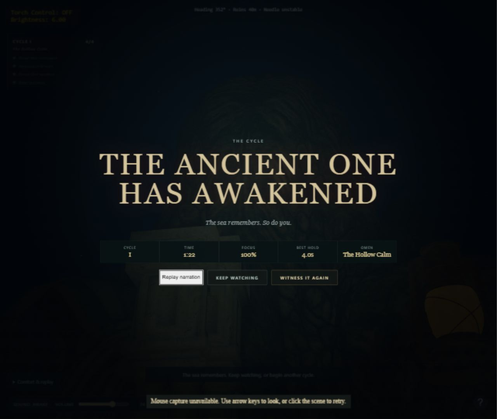
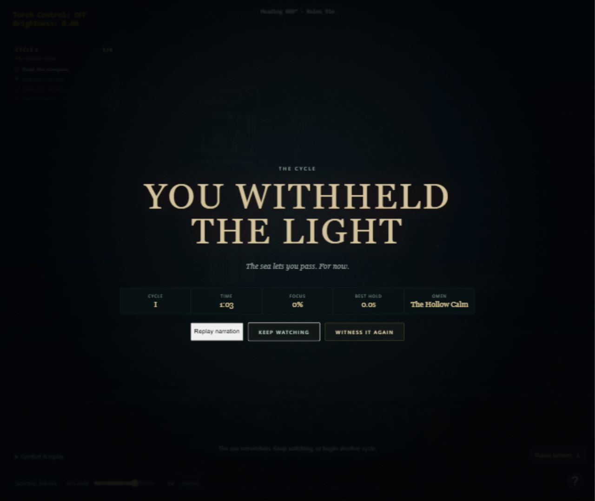
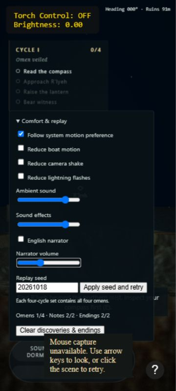

# Ritüel XIX — Yankının Sınanması

18 Ekim 2026 · **Kayıt üretimi, oyun entegrasyonu ve mevcut ortam doğrulaması tamam; insan dinleme ve normal tarayıcı kabulü açık.**

## Otomatik kontroller — PASS

- `node --test scripts/ritual-*.test.js`: 41/41 geçti. Önceki 33 teste ek olarak yedi anlatıcı kontrolü ve gerçek sahne olay adaptörü testi var. Finalin Tab sırası yeni yeniden okuma düğmesini de kapsıyor.
- `node scripts/validate.js`, ana dosya/anlatıcı/sunucu sözdizimi ve `git diff --check` geçti.
- `python scripts/verify-narration.py`: On MP3 FFmpeg ile hatasız çözüldü; son kodlanmış dosyaların ses seviyeleri bağımsız ölçüldü. Sonuçlar `evidence/ritual-19-audio-verification.json` içinde.
- Toplam teslim: **275.651 bayt (269,19 KiB)**, **33,531 saniye**. Temiz WAV kaynakları 1.213.368 bayt; model/motor dosyaları dağıtımın parçası değil. 3 MiB ses teslim hedefinin altında.
- Son MP3 ölçümleri: tümleşik ses yüksekliği **-20,9 ile -19,35 LUFS**, en yüksek gerçek tepe **-2,26 dBTP**. Doğrulama eşiği -24 ile -15 LUFS ve en fazla -1 dBTP idi. Bu ölçümler, insanın konuşmayı anladığı veya sesi ürkütücü bulduğu anlamına gelmez.
- Manifest/katalog eşleşmesi, dosya boyutları ve mevcut zaman aralıklarına sığma test edildi. İndirici üretilen paketin kesin model revizyonuna sabitlendi.

## Gerçek in-app Chromium — PASS

- Günlük kartında otomatik anlatım: `Narrator speaking` durumu gerçek fetch/decode/Web Audio başlangıcından sonra görüldü. Read aloud yeniden başlattı; Return to the sea kaydı durdurdu. Dünya kart boyunca durdu.
- Normal rota: pusula → C → ileri seyir → doğal uyanış → fener → oklarla hedef → **4/4, %100 odak, 4,0 sn tutuş**. Final kartında Replay narration ile tanıklık kaydı oynatıldı. Bu koşuda finalde ana ses kapalı görüldüğü için finalin otomatik sesinin açık olduğu iddia edilmiyor; final yeniden okuması açıkça doğrulandı.
- İnkâr: reset sonrası tanılama panelinden uyanış başlatıldı; 42 sn çizelge → Turn away → açık onay → You Withheld the Light. Kart açılır açılmaz otomatik `Narrator speaking` görüldü. Bu ikinci kontrol doğal yaklaşma rotasını kapsamaz.
- Klavyeyle Pause/Resume ve reset çalıştı. Aktif sesin ofsetle durması/devam etmesi ayrıca otomatik testte kapsanıyor; burada tüm klipler için insan dinlemesi yapılmadı.
- 360×800 görünümünde English narrator kapatıldı, ses %35'e indirildi; yenilemeden sonra DOM değerleri **false / 35** olarak korundu. Ayar paneline yükseklik sınırı ve kaydırma, keşif kartına taşma kaydırması eklendi. Bu bir mobil oynanabilirlik onayı değildir.
- Testten sonra anlatıcı açık / %80 ve normal görünüm geri yüklendi. Son kontrol aralığında yeni konsol error/warn yok.
- Kullanılabilen tarayıcı envanteri yalnız in-app Chromium ve MCP Apps içeriyor; normal Chrome/Edge/Firefox bu ortamdan erişilebilir değil.

## Açık kabul maddeleri

1. Normal Chrome, Edge ve Firefox'ta ses izinleri, iki son, dört alamet, gerçek işletim sistemi odak/sekme geçişi ve tekrar oynama matrisi. In-app kontrolü bunun yerine geçmez.
2. Üç gerçek dinleyiciyle kulaklık/hoparlör değerlendirmesi; en az ikisinin önemli cümleleri yardımsız anlayabilmesi. İnsan katılımcı veya dinleme sonucu uydurulmadı.
3. Cthulhu telaffuzu, ses karakterinin korku hissine katkısı ve fener/çevre sesleriyle dengenin insan değerlendirmesi. Yapılan frekans/seviye ölçümü bunun yerine sayılmaz.
4. Kontrollü soğuk ağ/düşük bant genişliği ölçümü. Sesler ihtiyaç oldukça yükleniyor ve başarısızlık oyunu engellemiyor; yavaş fetch/decode ve eski tur iptali otomatik sınır testleriyle doğrulandı, gerçek yavaş ağ testi yapılmadı.

XVI–XIX geliştirme dizisi ayrı main commitleriyle tamamlandı. Açık kabul maddeleri nedeniyle genel durum **Doğrulama bekliyor**; “tüm insan/tarayıcı testleri geçti” veya “yayına hazır” denmiyor. Türkçe kullanıcı kaydı sonraki pakettir. Push/yayın yapılmadı.
