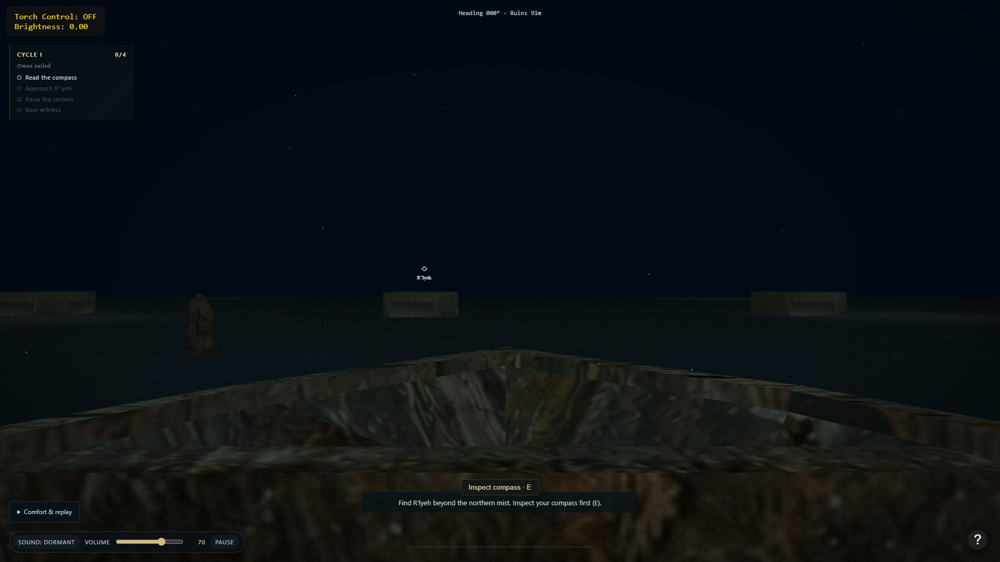
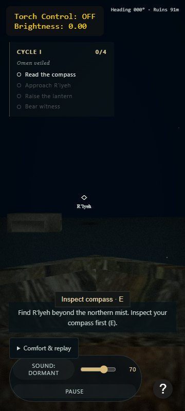

# Ritüel XX — Başlangıç Kaydı

28 Ekim 2026 · **Durum: Doğrulama bekliyor** (Başlangıç kaydı, otomatik testler ve yerel Chrome CDP ölçümleri tamamlandı; tam normal tarayıcı matrisi ve insan oynama/dinleme kabulü bağımsız QA'da açık.)

## Sorun, son davranış ve önemli uygulama kararları

Ritüel XXI–XXV ve XXVIII geliştirmelerine başlamadan önce çalışma ağacının durumu, başlangıç kod referansı, mevcut otomatik testlerin sonuçları, doğal rota oynanabilirliği, masaüstü ve 360×800 arayüz görünümü, performans başlangıç ölçümleri ve bilinen teknik/UX eksikleri kayıt altına alındı.

- **Başlangıç kod commit'i:** `554a131` (`ritual_19: verify narration audio and document acceptance results`).
- **Devir dokümanı commit'i (HEAD):** `095b470` (`Document AG implementation roadmap and independent QA handoff`).
- **Çalışma ağacı:** Temiz (`main` dalı, korunması gereken kirli kullanıcı değişikliği yok).
- **Karar:** Bu ritüelde üretim koduna dokunulmadı; yalnız yeniden üretilebilir başlangıç kanıtları (`docs/rituals/evidence/ritual-20-*`) ve bu başlangıç raporu eklendi. Eski ritüel kanıtlarının (`ritual-08` – `ritual-19`) hiçbirinin üzerine yazılmadı.

## Değişen modüller ve dosya eşlemesi

Üretim modüllerinde değişiklik yapılmadı. Eklenen kanıt ve rapor dosyaları:

- `docs/rituals/RITUAL_20_REPORT.md`
- `docs/rituals/evidence/ritual-20-desktop-1080p.jpg`
- `docs/rituals/evidence/ritual-20-small-360x800.jpg`
- `docs/rituals/evidence/ritual-20-baseline-voyage-1080p-medium.json`
- `docs/rituals/evidence/ritual-20-baseline-awakening-1080p-medium.json`

## Çalıştırılan komutlar, test ortamı ve sonuçlar

### 1. Otomatik doğrulama (PASS)

- **Ortam:** Windows 11, Node.js `v24.19.0`
- **CPU / GPU (cihaz envanteri):** Intel(R) Core(TM) i5-14450HX (10 çekirdek / 16 mantıksal işlemci), sistemde NVIDIA GeForce RTX 4060 Laptop GPU ve Intel(R) UHD Graphics mevcut.
- **Komutlar ve sonuçlar:**
  - `node --check main.js` → PASS (0 çıkış kodu)
  - `node --check scripts/serve.js` → PASS (0 çıkış kodu)
  - `node scripts/validate.js` → PASS (`woodBoat.obj`, `torch.obj`, `compass.obj`, `pillars.obj`, `Horror_low_subd.obj`, tüm gerekli statik dosyalar ve `low`/`medium`/`high` RIFF/WEBP dokuları doğrulandı)
  - `node --test scripts/ritual-*.test.js` → PASS (**41/41 test geçti**, 0 başarısız, ~822,5 ms)
  - `git diff --check` → PASS

### 2. Tarayıcı incelemesi ve performans başlangıcı (Chrome CDP)

- **Tarayıcı / Sürüm:** Google Chrome `146.0.7680.178` (`--headless=new --enable-gpu --ignore-gpu-blocklist`, yerel HTTP sunucusu `127.0.0.1:8120`)
- **Aktif WebGL 2 Renderer:** `ANGLE (Intel, Intel(R) UHD Graphics (0x0000A78B) Direct3D11 vs_5_0 ps_5_0, D3D11)`
- **Çözünürlük / DPR / Kalite / Önbellek:** `1920×1080` görünüm ve render boyutu, `DPR = 1`, `Medium` kalite (`waterSegments: 140`, `particles: 190`, `usePBR: true`), soğuk yenileme (`Page.reload({ ignoreCache: true })`).
- **İlk yükleme süresi (`initialLoadMs`):** `1774,8 ms` (8 adet yüksek varyant WebP doku + 5 OBJ/MTL model + 2 GLSL shader).
- **Normal seyir başlangıç ölçümü (`ritual-20-baseline-voyage-1080p-medium.json`):**
  - Örnek sayısı: `600` aktif kare
  - Son pencere FPS: `70,05 FPS`
  - Ortalama kare süresi (`meanFrameMs`): `14,27 ms`
  - `p95FrameMs`: `27,40 ms`
- **Uyanış / reveal başlangıç ölçümü (`ritual-20-baseline-awakening-1080p-medium.json`):**
  - Örnek sayısı: `600` aktif kare (`timelineElapsed ≈ 36,0 sn`)
  - Son pencere FPS: `38,93 FPS`
  - Ortalama kare süresi (`meanFrameMs`): `25,69 ms`
  - `p95FrameMs`: `34,80 ms`
  - Not: Headless Chromium'un entegre GPU (`Intel UHD Graphics`) kullanması ve kare içi matris/vektör/DOM güncellemeleri nedeniyle uyanış sekansında FPS 60'ın altına düşmektedir; bu tablo Ritüel XXV optimizasyonları için karşılaştırma tabanıdır.

## Doğal rota ile kısayol/hızlandırılmış rota ayrımı

1. **Doğal tam rota (Tanıklık sonu — `witness`):**
   - `F2` tanılaması veya zaman çizelgesi atlaması **kullanılmadan** gerçekleştirildi: `Inspect compass` → `C` ile pusulayı indirme → `W` ile kuzeydeki harabelere doğal seyir → `< 40 m` mesafede doğal uyanış tetiklemesi (`The Awakening Begins!`) → gerçek zamanlı `42 sn` uyanış çizelgesinin tamamlanması → `Raise lantern` → Cthulhu'nun gözlerine `4,0 sn` kesintisiz odaklanma.
   - **Sonuç:** `The Ancient One Has Awakened` kartı açıldı (`Cycle I`, süre `0:52`, odak `100%`, en iyi tutuş `4.0s`, görev `4/4`, alamet `The Hollow Calm`).
2. **İnkâr sonu erişim kontrolü (`refused` — doğal yaklaşma + hızlandırılmış uyanış çizelgesi):**
   - Pusula inceleme ve harabelere doğal seyir sonrası uyanış doğal olarak tetiklendi; uyanış çizelgesi test betiğinde hızlandırılarak tamamlandı (`42 sn` gerçek zamanlı beklenmediği için bu koşu "doğal yaklaşma + hızlandırılmış çizelge" olarak ayrılmıştır, tam doğal rota sayılmaz).
   - `Turn away · B` (`#reject-light`) açıldı → önce `Keep the light` (`#reject-cancel`) ile iptal edilip oyunun devam ettiği doğrulandı (`choiceCancelWorks: true`) → tekrar açılıp `Extinguish the lantern and turn away` (`#reject-confirm`) onaylandı → `You Withheld the Light` kartı (`Cycle I`, görev `2/4`, alamet `The Hollow Calm`) doğrulandı.

## Başlangıç ekran kanıtları

## Tespit edilen bilinen sorunlar (Ritüel XXI–XXV ve XXVIII girdisi)

1. **Ritüel XXI (Sessiz Güverte) için tespitler:**
   - Normal HUD'da sol üstte teknik `Torch Control: OFF / Brightness: 0.00` (`#torch-ui`) kutusu sürekli görünüyor; `F2` tanılama paneline taşınmalı.
   - `1920×1080` ve özellikle `360×800` görünümde `#inspect-compass` düğmesi `#voyage-hint` kutusunun üst kenarıyla çakışıyor; `#comfort-controls` dar ekranda `#audio-controls` ile üst üste biniyor; `#ritual-caption` ve `#voyage-hint` aynı alt merkez bölgesinde birbirine çok yakın duruyor.
   - Kalıcı altyazı boyutu (`captionSize`) ve altyazı görünürlüğü (`captionsEnabled`) tercihi henüz yok.
2. **Ritüel XXII (Gerçek Temas) için tespitler:**
   - Çarpışma yalnız `js/discovery-system.js` içindeki işaret taşı (`stone`, `collisionRadius: 1.25`) için tanımlı; sahnedeki üç sütun (`[-50, 0, -30]`, `[0, 0, -30]`, `[50, 0, -30]`, ölçek `500.2`) çarpışma sistemine bağlı değil.
   - Keşif noktaları (`discoveries.nearby`) yalnız yatay mesafeye (`<= 18`) bakıyor; oyuncunun keşif nesnesine bakış açısı veya aradaki katı engelin görüş hattını (`line-of-sight`) kapatması kontrol edilmiyor.
3. **Ritüel XXIII (Zamanında Gelen Fısıltı) için tespitler:**
   - `js/narration-system.js` içinde uyanış olayları için istek anından başlayan (ve duraklatılmış süreyi hariç tutan) bir geçerlilik süresi (`TTL`) bulunmuyor; ağ/decode gecikmesinde eski bir uyanış cümlesi yeni sahne anının üstüne konuşabilir veya altyazısını ezebilir.
4. **Ritüel XXIV (Ayrılan Düğümler) için tespitler:**
   - `main.js` (1883 satır) sahne durumunu, dünya geometrisini, WebGL kurulumunu/çizimini ve DOM olay bağlamalarını tek dosyada topluyor; `scripts/ritual-08.test.js` üretim kodunu `source.slice(0, source.indexOf('\n// BOOTSTRAP'))` ile metin keserek yüklüyor.
5. **Ritüel XXV (Ölçülü Akış) için tespitler:**
   - `drawScene` her karede çok sayıda geçici `mat4`/`vec3`/`vec4` nesnesi tahsis ediyor ve değer değişmese bile `torch-brightness`, `compass-readout` gibi DOM düğümlerini güncelliyor.
   - Başlangıç kalite seçimi varsayılan olarak `High` (`dpr: 2`); entegre GPU'larda `Medium` daha dengeli bir varsayılan olarak değerlendirilmeli.

## Erişilemeyen kontroller ve bağımsız QA'ya kalan işler

- Normal masaüstü Chrome, Edge ve Firefox pencerelerinde 24 tam rotalık (`3 tarayıcı × 4 alamet × 2 son`) etkileşimli matris ve gerçek işletim sistemi sekme/pencere odak geçişleri bu ortamda otomatik CDP oturumuyla ikame edilmedi.
- `360×800` kontrolü yalnız dar görünüm/CSS yerleşim doğrulamasıdır; dokunmatik veya mobil oynanabilirlik desteği anlamına gelmez.
- Gerçek insan oyuncu testi (en az 3 yeni katılımcı) ve kulaklık/hoparlör ile insan dinleme değerlendirmesi (en az 3 dinleyici) yapılmadı; bağımsız QA (Ritüel XXIX) kapsamındadır.
