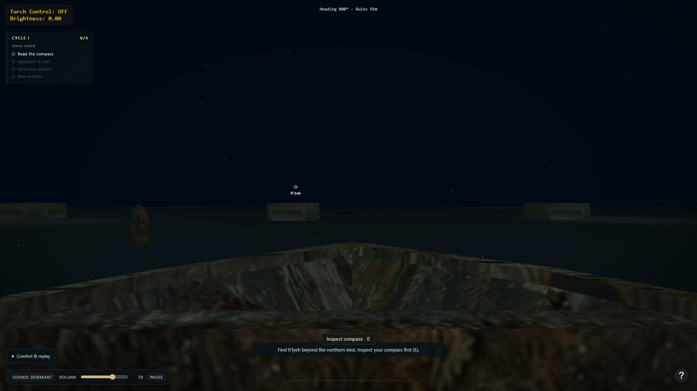
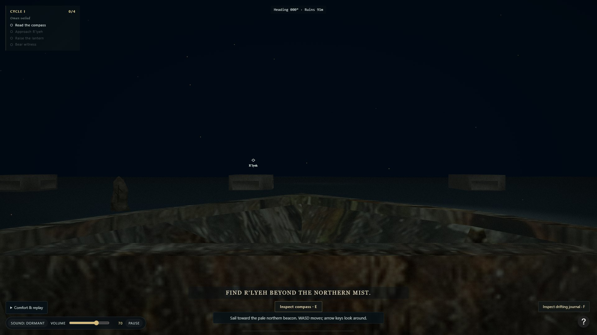
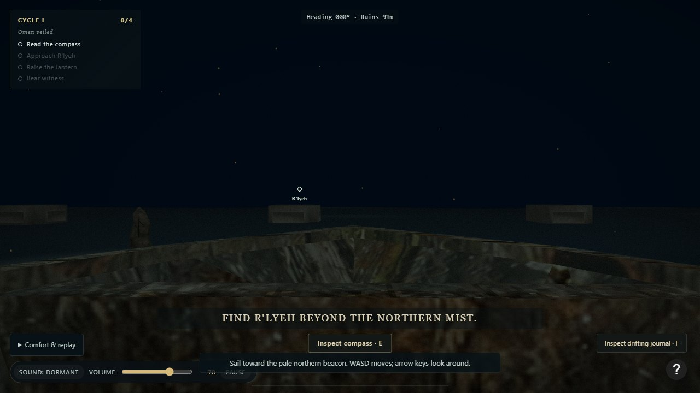
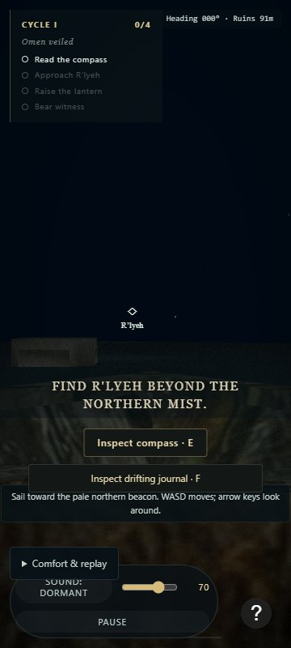
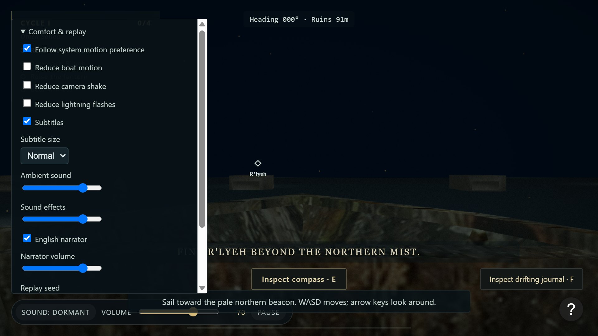

# Ritüel XXI — Sessiz Güverte

28 Ekim 2026 · **Durum: Doğrulama bekliyor** (Geliştirme, otomatik regresyon testleri ve Chrome CDP çoklu çözünürlük doğrulaması tamamlandı; bağımsız QA kabulü açıktır.)

## Sorun, son davranış ve önemli uygulama kararları

Normal seyir esnasında ekranda gereksiz teknik bilgilerin (sol üstte sarı `Torch Control: OFF / Brightness: 0.00` kutusu) oyuncunun dikkatini dağıtması ve alt orta bölgede `#inspect-compass`, `#voyage-hint` ve `#ritual-caption` öğelerinin birbirine çok yakın konumlanarak dar ekranlarda çakışması sorunu çözüldü.

1. **Teknik HUD öğeleri F2 paneline taşındı:**
   - `#torch-ui` normal HUD'dan kaldırıldı. `Torch mode` ve `Brightness` değerleri `#debug-torch-info` kapsayıcısı altında `F2` sahne tanılaması (`#debug-panel`) içine taşındı.
   - Oyuncu normal seyirde feneri yaktığında (`L` tuşu veya bağlamsal düğme), hedef arama ve odaklanma aşamasında merkezdeki hedef halkası (`#witness-focus`), navigasyon rehberliği (`#voyage-hint`) ve görev listesi (`#objective-panel`) üzerinden durumu temiz ve atmosferik biçimde takip eder.
2. **Çakışmayan katmanlı yerleşim düzeni (Zoning):**
   - **Üst alan:** Sol üstte `#objective-panel` (`top: 18px; left: 18px;`), üst merkezde `#compass-readout` (`top: 18px; left: 50%`).
   - **Alt rehberlik ve etkileşim alanı:**
     - En altta ilerleme çizgisi (`#ritual-progress`, `bottom: 12px;`).
     - Hemen üzerinde sürekli rehberlik metni (`#voyage-hint`, `bottom: 24px;`).
     - Rehberliğin üzerinde o aşamada yapılması gereken birincil eylem düğmesi (`#inspect-compass` veya keşif anında `#discovery-actions`, `bottom: 74px;`).
     - Eylemin üzerinde bağımsız ve okunabilir anlatıcı altyazıları (`#ritual-caption`, `bottom: 118px;`, yarı saydam koyu arka plan desteğiyle).
   - **Küçük ekran (360×800) dikey akışı:** Düğmeler ve rehberlik kutuları yan yana sıkışmak yerine dikey hiyerarşiyle dizildi (`#audio-controls` `bottom: 12px;`, `#comfort-controls` `bottom: 84px;`, `#voyage-hint` `bottom: 144px;`, `#discovery-actions` `bottom: 192px;`, `#inspect-compass` `bottom: 236px;`, `#ritual-caption` `bottom: 284px;`).
3. **Kalıcı altyazı tercihi ve boyutu:**
   - `ComfortSettings` içine `captionsEnabled` (boolean, varsayılan `true`) ve `captionSize` (`'small' | 'normal' | 'large'`, varsayılan `'normal'`) eklendi.
   - Tercihler `localStorage` üzerinde `ritual-comfort` anahtarında kalıcıdır.
   - Altyazılar kapatıldığında zorunlu görev bilgisi (`#objective-panel`) ve seyir rehberliği (`#voyage-hint`) kesinlikle etkilenmez ve tam olarak görünür kalır.
   - Altyazı boyutuna göre `data-caption-size` CSS seçicisi font boyutunu orantılı olarak ayarlar (`small`: ~0.8rem, `normal`: ~1.0rem, `large`: ~1.25rem).
4. **Erişilebilirlik ve klavye odağı:**
   - Klavye kullanıcıları için `:focus-visible` ile belirgin altın sarısı odak halkası (`outline: 2px solid #d5ba79; outline-offset: 2px;`) tüm etkileşimli öğelere tanımlandı.
   - Modal pencerelerde (`#pause-screen`, `#ending-card`, `#discovery-card`, `#choice-card`) `Tab` döngüsü korunur; `Escape` tuşu keşif kartını ve son seçimi iptal kartını kapatarak sahneye ve canvas odağına geri döner.
   - %200 tarayıcı büyütmesinde pencereler ve konfor ayarları dikey kaydırma (`overflow-y: auto`) ile tüm kontrollere erişim sağlar.

## Değişen modüller ve dosya eşlemesi

- `index.html`: `#torch-ui` normal HUD'dan kaldırıldı; `#debug-torch-info` `#debug-panel` içine eklendi; altyazı açık/kapalı ve boyut seçimleri `#comfort-controls` altına eklendi.
- `css/style.css`: Küresel `:focus-visible` stili; çakışmayan dikey HUD katmanları; altyazı boyutu sınıfları; 360×800 ve 200% zoom responsive kuralları.
- `js/comfort-settings.js`: `captionsEnabled` ve `captionSize` doğrulama, saklama ve yükleme mantığı.
- `js/ritual-presentation.js`: `applyCaptionSettings` metodu; altyazı kapalıyken altyazıyı bastırma ve boyut niteliğini DOM'a yansıtma.
- `main.js`: `RitualPresentation`'a `comfortSettings` aktarımı, altyazı kontrol olay dinleyicileri ve `Escape` modal kapatma yönetimi.
- `scripts/ritual-21.test.js`: Yeni otomatik test paketi (4 yeni test).

## Çalıştırılan komutlar ve sonuçlar

- `node --check main.js; node --check js/comfort-settings.js; node --check js/ritual-presentation.js` → PASS
- `node scripts/validate.js` → PASS
- `node --test scripts/ritual-*.test.js` → PASS (**45/45 test geçti**, 0 hata, ~630 ms)
- `git diff --check` → PASS

### Tarayıcı kontrolleri (Chrome CDP)

- **1920×1080 (Masaüstü):** Normal ekranda `#torch-ui` yok; F2 tanılamasında `Torch mode: OFF · Brightness: 0.00` doğrulandı. Altyazı, eylem düğmesi ve seyir rehberliği çakışmasız görüntülendi.
- **1280×720 (Standart HD):** Dikey hizalama ve boşluklar korundu.
- **360×800 (Küçük Ekran Kontrolü):** `#inspect-compass`, `#discovery-actions`, `#voyage-hint` ve ses/konfor düğmeleri dikey hizada çakışmasız doğrulandı. (Bu test mobil/dokunmatik oynanabilirlik onayı değildir).
- **200% Zoom (960×540 / DPR 2):** `#comfort-controls` açıkken kaydırma çubuğu ve tüm ayar düğmeleri görünür ve erişilebilir kaldı.
- **Klavye Escape:** `inspectDiscovery('journal')` ile açılan not kartının `Escape` ile kapandığı ve sahnenin devam ettiği CDP ile doğrulandı.

## Önce / Sonra kanıtları

````carousel

<!-- slide -->

<!-- slide -->

<!-- slide -->

<!-- slide -->

````

Ek kanıt dosyaları:
- `docs/rituals/evidence/ritual-21-desktop-1080p.jpg`
- `docs/rituals/evidence/ritual-21-desktop-720p.jpg`
- `docs/rituals/evidence/ritual-21-small-360x800.jpg`
- `docs/rituals/evidence/ritual-21-zoom-200.jpg`

## Bilinen kusurlar ve bağımsız QA'ya kalan işler

- Normal masaüstü Firefox ve Edge üzerinde yerel işletim sistemi fare kilidi ve klavye sekme sırası bağımsız QA (Ritüel XXIX) matrisinde doğrulanmalıdır.
- 360×800 kontrolleri yalnızca CSS görünüm testidir; tam mobil dokunmatik kontroller kapsam dışıdır.
- Gerçek insan katılımcılarla arayüzün dikkat dağıtıcılığı ve altyazı boyutu okunurluğu değerlendirilmelidir.
